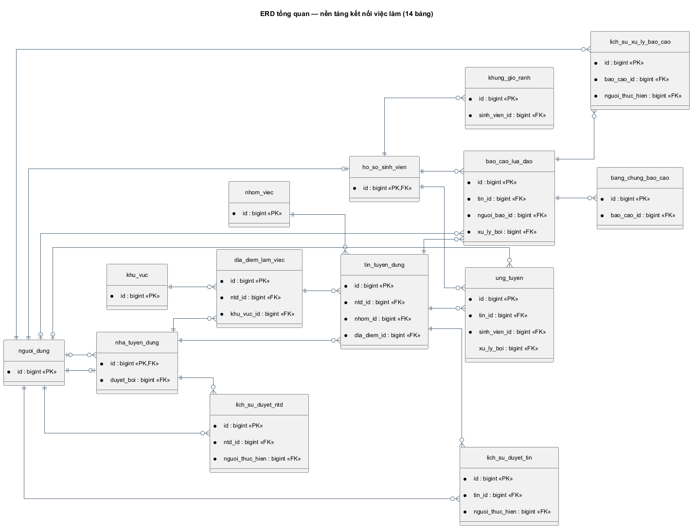
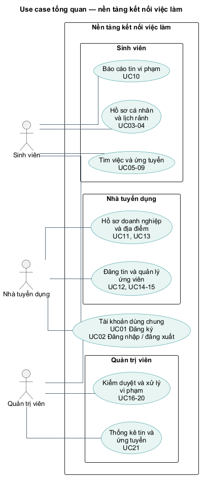

# Nhóm Bá Khí · Quản lý việc làm sinh viên

**Nền tảng kết nối sinh viên với nhà tuyển dụng**

Đồ án môn **INT4211 – Lập trình trên các thiết bị di động · HK261 · Đề tài 25**

## 📌 Liên kết dành cho giảng viên

> ### [📊 XEM TIẾN ĐỘ & PHÂN CÔNG NHIỆM VỤ](https://doubled1302.github.io/nhomBaKhi/)
>
> Trang theo dõi công việc của nhóm: tổng quan tiến độ, nhiệm vụ từng thành viên, bảng Kanban và các mốc thực hiện.

| Nội dung cần kiểm tra | Đường dẫn |
| --- | --- |
| **Tiến độ và phân công nhiệm vụ** | **[Mở trang quản lý dự án](https://doubled1302.github.io/nhomBaKhi/)** |
| **Sơ đồ ERD** | **[Xem toàn bộ ERD](./docs/ERD/README.md)** · [Ảnh tổng quan](./docs/ERD/00_ERD_tong_quan.png) |
| **Sơ đồ Use Case** | **[Xem toàn bộ Use Case](./docs/UseCase/README.md)** · [Ảnh tổng quan](./docs/UseCase/00_Tong_quan.png) |
| Kế hoạch và bảng phân công dạng Word | [Tải tài liệu phân công](./docs/Phan_Cong_Cong_Viec_Nhom_De25.docx) |
| Lịch sử đóng góp mã nguồn | [Xem các commit của nhóm](https://github.com/doubleD1302/nhomBaKhi/commits/main/) |
| Hướng dẫn cài đặt và chạy | [HUONG_DAN_CHAY_PROJECT.txt](./HUONG_DAN_CHAY_PROJECT.txt) |
| Tài liệu API | [backend/api.md](./backend/api.md) |
| Checklist đối chiếu yêu cầu môn học | [PHU_LUC_4_CHECKLIST.txt](./PHU_LUC_4_CHECKLIST.txt) |

## Giới thiệu và phạm vi thiết kế

Dự án xây dựng nền tảng việc làm cho sinh viên với ba nhóm người dùng:

- **Sinh viên:** tạo hồ sơ, thiết lập lịch rảnh, tìm việc, ứng tuyển và báo cáo tin vi phạm.
- **Nhà tuyển dụng:** quản lý hồ sơ doanh nghiệp, địa điểm làm việc, tin tuyển dụng và hồ sơ ứng viên.
- **Quản trị viên:** duyệt hồ sơ và tin đăng, xử lý báo cáo vi phạm, quản lý tài khoản và xem thống kê.

Bộ ERD và Use Case trong `docs/` mô tả phạm vi kết nối ứng viên với nhà tuyển dụng. Thông tin lương trong tin đăng hỗ trợ sinh viên lựa chọn việc; bộ thiết kế này không bao gồm nhận ca, chấm công, tính lương hoặc chi trả.

## Thành viên và phân công

| Mã | Thành viên | MSSV | Phần việc phụ trách |
| --- | --- | --- | --- |
| TV01 | Nguyễn Đức Đạt | 231A290126 | Backend REST API và hạ tầng Cloud |
| TV02 | Nguyễn Đỗ Hoàng Anh | 231A0290111 | Ứng dụng Android cho nhà tuyển dụng và quản trị |
| TV03 | Hà Gia Bảo | 231A010014 | Ứng dụng Flutter cho sinh viên |
| TV04 | Võ Trần Kim Tuyến | 241A310165 | Cơ sở dữ liệu, thiết kế ERD và kiểm thử QA |

Xem từng nhiệm vụ, thời hạn và trạng thái tại **[trang tiến độ và phân công nhiệm vụ](https://doubled1302.github.io/nhomBaKhi/)**. Danh sách thành viên được đối chiếu với [dữ liệu kế hoạch trong repository](./web-dashboard/tasks-data.js).

## Sơ đồ ERD

Bộ thiết kế gồm **5 sơ đồ**, trong đó sơ đồ tổng quan mô tả **14 bảng**.

| Sơ đồ | Xem trực tiếp |
| --- | --- |
| Tổng quan các bảng và quan hệ | [PNG](./docs/ERD/00_ERD_tong_quan.png) · [SVG](./docs/ERD/00_ERD_tong_quan.svg) |
| Tài khoản, hồ sơ và địa điểm | [PNG](./docs/ERD/01_ERD_tai_khoan.png) · [SVG](./docs/ERD/01_ERD_tai_khoan.svg) |
| Tin tuyển dụng và ứng tuyển | [PNG](./docs/ERD/02_ERD_tuyen_dung.png) · [SVG](./docs/ERD/02_ERD_tuyen_dung.svg) |
| Kiểm duyệt | [PNG](./docs/ERD/03_ERD_kiem_duyet.png) · [SVG](./docs/ERD/03_ERD_kiem_duyet.svg) |
| Báo cáo tin vi phạm | [PNG](./docs/ERD/04_ERD_bao_cao_lua_dao.png) · [SVG](./docs/ERD/04_ERD_bao_cao_lua_dao.svg) |

[Xem thuyết minh và mã nguồn PlantUML của ERD](./docs/ERD/README.md).

## Sơ đồ Use Case

Bộ thiết kế gồm **8 sơ đồ**, mô tả **21 Use Case** với ba tác nhân: Sinh viên, Nhà tuyển dụng và Quản trị viên.

| Sơ đồ | Xem trực tiếp |
| --- | --- |
| Tổng quan hệ thống | [PNG](./docs/UseCase/00_Tong_quan.png) · [SVG](./docs/UseCase/00_Tong_quan.svg) |
| Chức năng sinh viên | [PNG](./docs/UseCase/01_SV.png) · [SVG](./docs/UseCase/01_SV.svg) |
| Chức năng nhà tuyển dụng | [PNG](./docs/UseCase/01_NTD.png) · [SVG](./docs/UseCase/01_NTD.svg) |
| Chức năng quản trị viên | [PNG](./docs/UseCase/01_QT.png) · [SVG](./docs/UseCase/01_QT.svg) |
| Tìm việc và ứng tuyển | [PNG](./docs/UseCase/02_Chi_tiet_tim_viec_ung_tuyen.png) · [SVG](./docs/UseCase/02_Chi_tiet_tim_viec_ung_tuyen.svg) |
| Đăng và quản lý tin | [PNG](./docs/UseCase/03_Chi_tiet_quan_ly_tin.png) · [SVG](./docs/UseCase/03_Chi_tiet_quan_ly_tin.svg) |
| Kiểm duyệt | [PNG](./docs/UseCase/04_Chi_tiet_kiem_duyet.png) · [SVG](./docs/UseCase/04_Chi_tiet_kiem_duyet.svg) |
| Báo cáo tin vi phạm | [PNG](./docs/UseCase/05_Chi_tiet_bao_cao_lua_dao.png) · [SVG](./docs/UseCase/05_Chi_tiet_bao_cao_lua_dao.svg) |

[Xem thuyết minh và mã nguồn PlantUML của Use Case](./docs/UseCase/README.md).

## Cấu trúc repository

| Thư mục | Nội dung |
| --- | --- |
| [`backend/`](./backend/) | Backend Node.js 20, Express, JWT/bcrypt và PostgreSQL |
| [`client-flutter/`](./client-flutter/) | Dự án ứng dụng Flutter/Dart cho sinh viên |
| [`admin-android/`](./admin-android/) | Dự án ứng dụng Android Java/XML cho nhà tuyển dụng và quản trị |
| [`web-dashboard/`](./web-dashboard/) | Website theo dõi tiến độ, phân công và báo cáo công việc |
| [`docs/ERD/`](./docs/ERD/README.md) | Ảnh PNG, SVG và mã nguồn PlantUML của sơ đồ dữ liệu |
| [`docs/UseCase/`](./docs/UseCase/README.md) | Ảnh PNG, SVG và mã nguồn PlantUML của sơ đồ chức năng |
| [`docs/`](./docs/) | Hồ sơ phân công và tài liệu thiết kế |

## Hướng dẫn kiểm tra và chạy dự án

1. **Kiểm tra tiến độ:** mở [website quản lý dự án](https://doubled1302.github.io/nhomBaKhi/), xem tổng quan và lọc nhiệm vụ theo thành viên.
2. **Kiểm tra thiết kế:** mở [ERD](./docs/ERD/README.md) và [Use Case](./docs/UseCase/README.md); dùng PNG để xem nhanh, SVG để phóng to hoặc `.puml` để chỉnh sửa.
3. **Kiểm tra mã nguồn:** mở thư mục thành phần tương ứng, đối chiếu với [tài liệu API](./backend/api.md) và [checklist môn học](./PHU_LUC_4_CHECKLIST.txt).
4. **Cài đặt và chạy:** làm theo [hướng dẫn chạy dự án](./HUONG_DAN_CHAY_PROJECT.txt). Website tiến độ có thể mở riêng bằng [Mo_Web_Theo_Doi.bat](./Mo_Web_Theo_Doi.bat).

### Lưu ý về tính đồng bộ

Phạm vi tài liệu thiết kế được công bố ở đây là **quản lý việc làm sinh viên**. Dashboard hiện còn một số nhãn SmartTro/nhà trọ từ cấu hình cũ; mã nguồn và hướng dẫn API cũng còn các nghiệp vụ ca làm, chấm công và bảng lương ngoài phạm vi bộ thiết kế. Các nội dung này cần được nhóm đồng bộ và đối chiếu với kết quả kiểm thử thực tế khi nghiệm thu.
